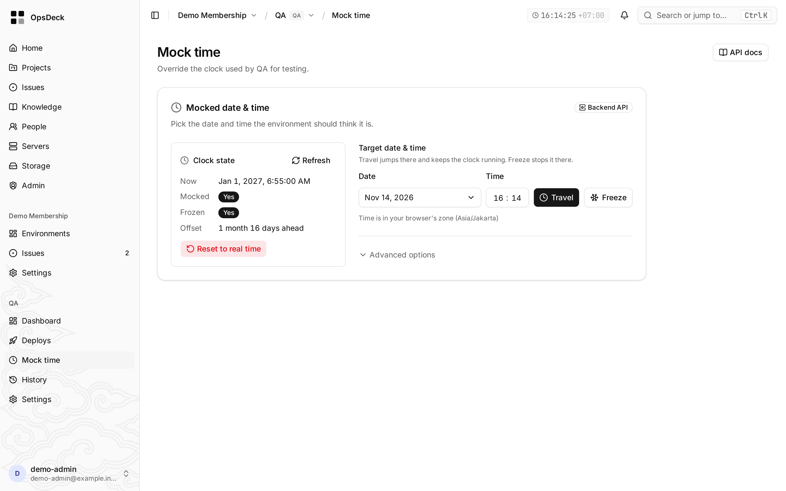
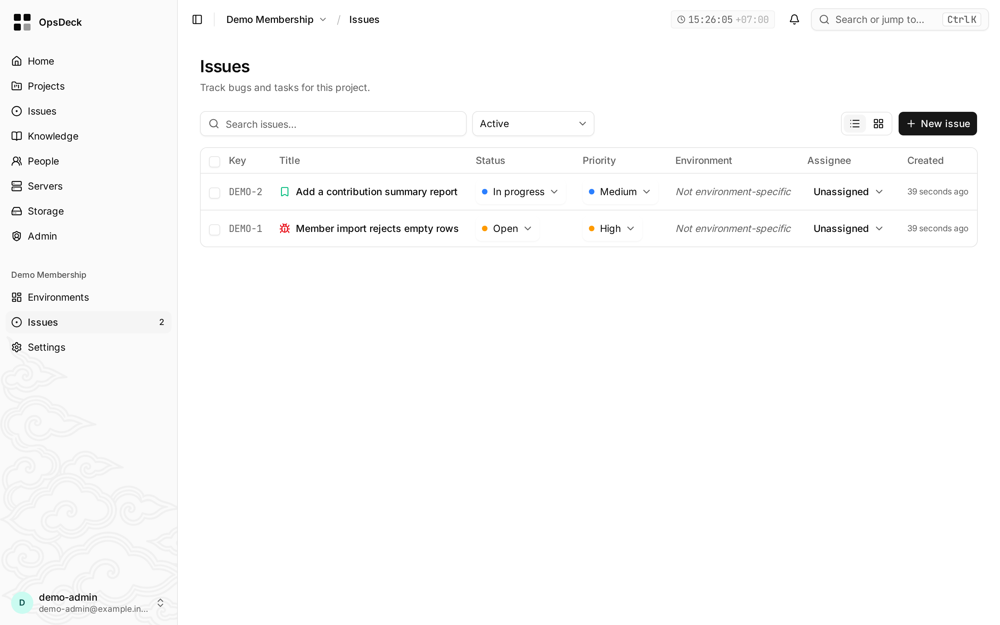

# Menara

A self-hosted operations panel for teams that run the same products for many
clients, each with its own Dev, QA and UAT environments on its own servers.

One screen per client environment shows what is deployed there and how to roll
it back, what its services, variables and databases look like, what mail it
just sent, what time the application thinks it is, and which issues are open
against it.



> **Status.** Menara was built for one team. There it replaced Jenkins as the
> deploy tool and runs their client environments every day. It has one
> maintainer and is shared in case it fits teams with the same shape. Expect
> rough edges outside that setup, and read [`SECURITY.md`](SECURITY.md) before
> you install it.

## Where it fits

Coolify, Dokploy and similar panels build your apps from source and decide how
they run. Menara takes over after that: your CI builds images or artifacts,
and Menara deploys them onto servers you already run. Two things set it
apart:

- **Mixed fleets.** Compose apps and legacy artifacts (a JAR run by a systemd
  unit, or a static site served by nginx) deploy from the same CI
  notification, with the same locks, health checks and rollback.
- **Testing date-driven systems.** Each environment can move its application
  clock forward or back through a small HTTP contract, so QA can test
  month-end, interest and expiry rules without waiting for the calendar.
  [`docs/time-mocking-api.md`](docs/time-mocking-api.md) describes the
  contract and how to implement it in your app.

## Features

Work is organised as **projects**, each with **environments** (Dev, QA, Demo,
…).

**Environments**

- A setup wizard that prepares the server, database and address, then deploys
  the first build. It can also start from a copy of another environment.
- Services with their logs and actions, variables (secrets encrypted at rest),
  and databases with backup, restore and provisioning.
- Mail capture through Mailpit, mock time, and a history of everything done to
  the environment.

**Deploys and releases**

- Deploys triggered by build notifications from Woodpecker or Bitbucket, with
  deploy locks, health checks, rollback and a timeline per target. See
  [`docs/deploy.md`](docs/deploy.md).
- Tested JAR and static builds can be marked as releases and kept for
  download.

**Issues and knowledge**

- Issues with comments and milestones per project, with optional Jira sync
  and opt-in push back to Jira ([`docs/jira.md`](docs/jira.md)). They let testers see an environment's
  open problems next to its deploys. They are not meant to replace a full
  tracker.
- A knowledge base with revisions, per-role visibility and a Markdown import.



**Assistant** (optional)

- Answers members' questions about the projects they can see. It reads the
  source at the commits an environment runs (or at the project's branches),
  issues, deploys and, when allowed, the environment's database.
- Database access goes through a read-only login behind a SQL gate that lets
  only a single `SELECT` through, and sensitive columns are masked. Files that
  may hold secrets are never shown to the model.
- Turns a conversation into a BRD section or a Jira issue draft.
- Runs on Anthropic, OpenAI, Google or any OpenAI-compatible endpoint with
  your API key. Daily usage is metered per user against the prices you set.

**Infrastructure**

- Servers with SSH key rollout, a browser terminal and a file explorer.
- S3 connections with a file browser, Cloudflare zones and tunnels, and CI
  connections.

**People and the instance**

- Job-based access roles, per-project membership, and a people directory with
  local time and working hours.
- An activity log, scheduled instance backups, branding, and self-update from
  GitHub Releases.

Sign-in uses email and password with an authenticator app, passkeys, or
Microsoft Entra ID ([`docs/microsoft-sign-in.md`](docs/microsoft-sign-in.md)).
The terminal, file explorers, secrets and admin settings require one of the
strong methods. The UI is available in English, Indonesian, Spanish, Chinese
and Arabic.

## Install

You need a Linux host with systemd (amd64 or arm64) and Docker Engine with
Compose 2.23.1 or later. On Debian and Ubuntu the installer adds Docker if
it's missing.

Download the installer, check that this repository's release workflow built
it, then run it:

```sh
curl -fsSLO https://github.com/romikusumabakti/menara/releases/latest/download/install.sh
gh attestation verify install.sh -R romikusumabakti/menara
sh install.sh --hostname app.example.com --dry-run   # prints every action
sh install.sh --hostname app.example.com
```

The installer checks every other asset against its sha256 in the release's
`release.json` and pins every image by digest. It then creates `/opt/<name>`
with `compose.yaml` and a `.env` (mode 0600) holding generated secrets,
installs a host updater unit (`menara-updater@<name>.path`) and starts the
stack.

| Flag | Purpose |
| ---- | ------- |
| `--channel stable\|beta`, `--version vX.Y.Z` | Which release to install |
| `--dir /opt/<name>`, `--http-port N` | Where the instance lives, and its local port |
| `--adopt <old .env>` | Take over a stack started from the repo-root `compose.yaml`, keeping its volumes |
| `--restore <backup> --secrets-key-file <file>` | Disaster recovery from a local or S3 backup |
| `--dry-run` | Check and print every action without changing anything |

`sh install.sh --help` and the header of
[`ops/install/install.sh`](ops/install/install.sh) describe the full contract.

After the first start:

1. **Create the first admin** at `<url>/setup`.
2. **Store `SECRETS_KEY` offline.** Backups never contain it, and a restore
   needs it.
3. **Put TLS in front.** Caddy serves plain HTTP on `127.0.0.1` only, so
   Menara can't be reached until you add a tunnel (for example cloudflared)
   or a TLS-terminating reverse proxy. Don't expose that port directly, or
   passwords and session cookies travel in cleartext.

Admin › Instance handles updates, backups and branding from then on. The
updater migrates the database first and rolls the images back if the new
version fails to start.

## The `menara` CLI

The image puts the CLI on `PATH` as `menara`. On a server run it with
`docker exec <app container> menara <command>`. In a checkout use
`bun scripts/cli.ts <command>`.

```
menara migrate [--adopt]        Apply pending migrations
menara backup run [--trigger …] Back up the instance (S3 destination or local)
menara restore <objectKey>      Restore an instance backup (run by the updater)
menara seed demo [--print-passwords] [--force]
menara knowledge import <folder> --as <email> [--dry-run] [--update-visibility]
```

**`seed demo`** fills a beta or test instance with fictional data: five
projects with Dev/QA/Demo environments on placeholder `.invalid` servers, a
month of finished deploys, issues with comments and milestones, a small
knowledge base, staff who can't sign in, and one sign-in account per role. It
never changes existing rows, and running it again adds nothing.

**`knowledge import`** publishes every `*.md` file in a folder as a knowledge
document, written as the `--as` user (who needs `knowledge:manage`). Each file
starts with YAML front matter:

```yaml
---
collection: Team Guides
title: Deploy Flow
slug: deploy-flow     # recommended: identifies the document across runs
docType: runbook      # optional: doc (default), runbook, spec, requirement
visibleTo: [infra]    # optional: the collection's roles; [] = everyone
---
```

Documents are matched by slug, or by the title's slug with a warning when the
file has none. Unchanged files are skipped, changed ones get a new revision,
and links between the files become `/knowledge/<slug>` links. The whole
folder is checked before anything is written, so a single bad file (an
unknown role, say) stops the run. `menara knowledge --help` has the details.

The CLI reads the folder from inside the app container, so copy it in first:

```sh
docker compose -f /opt/<name>/compose.yaml cp ./guides app:/tmp/kb
docker compose -f /opt/<name>/compose.yaml exec app \
  menara knowledge import /tmp/kb --as you@example.com --dry-run
```

If the plan looks right, run it again without `--dry-run`.

## Documentation

- [`docs/deploy.md`](docs/deploy.md): deploys, locks, health checks, rollback,
  and what CI has to send
- [`docs/time-mocking-api.md`](docs/time-mocking-api.md): the clock contract
  and how to implement it
- [`docs/jira.md`](docs/jira.md): Jira sync
- [`docs/microsoft-sign-in.md`](docs/microsoft-sign-in.md): Entra ID sign-in
- [`SECURITY.md`](SECURITY.md): threat model, audit trail, supply chain, known
  gaps

## Development

Menara runs on Bun, with a Vite + React SPA, a Hono API, PostgreSQL through
Drizzle, and BullMQ on Valkey. [`CONTRIBUTING.md`](CONTRIBUTING.md) covers
local setup, the stack, tests, migrations and releases.

## License

[MIT](LICENSE)
