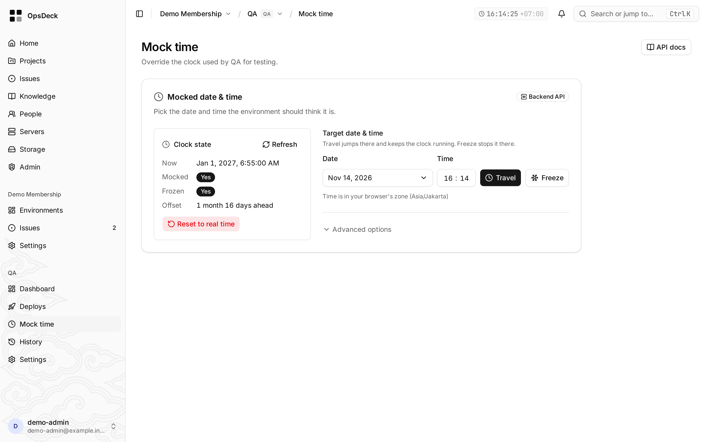
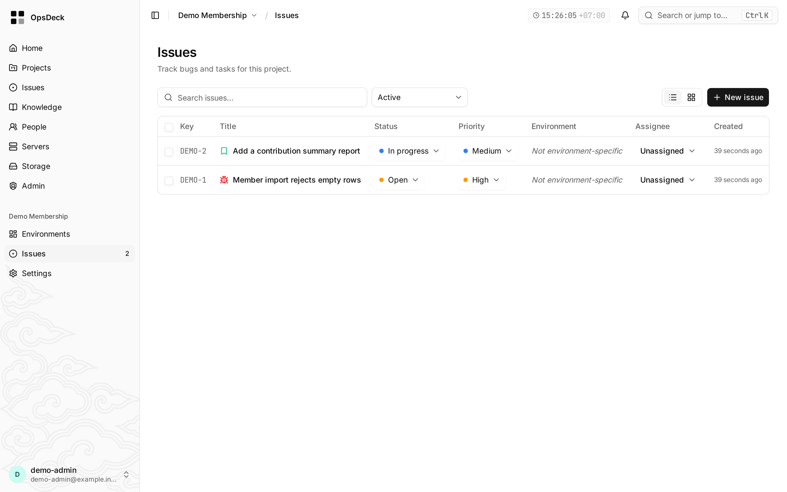

# OpsDeck

A self-hosted operations panel for software houses and consultancies that run
the same products for many clients, each with its own Dev, QA and UAT
environments on its own servers.

It answers, on one screen per client environment: what is deployed there, how
to roll it back, what its database and variables look like, what mail it just
sent, what time its application thinks it is, and which issues are open
against it.



> **Status.** OpsDeck was built for one team, where it replaced Jenkins as
> the deploy tool and runs their client environments every day. It has one
> maintainer. It's shared in case it fits teams with the same shape; expect
> rough edges outside that setup, and read [`SECURITY.md`](SECURITY.md)
> before installing it.

## Why another panel

Two things set it apart from general PaaS panels:

- **Mixed fleets.** Container apps (Compose) and legacy artifacts (a JAR run
  by a systemd unit, or a static site served by nginx) deploy from the same CI
  notification, with the same locks, health checks and rollback.
- **Testing support for date-driven systems.** Each environment can move its
  application clock forward or back through a small HTTP contract
  ([`docs/time-mocking-api.md`](docs/time-mocking-api.md)), so QA can test
  month-end, interest and expiry rules without waiting for the calendar. The
  doc includes how to implement the contract in your app.

Coolify, Dokploy and similar panels build your apps from source and own how
they run. OpsDeck starts later: your CI builds the images or artifacts, and
OpsDeck deploys them onto the servers you already run, into a Compose project
or in place of a JAR or a static web root.

## What's in it

Each project has environments (Dev, QA, …), and the panel ties together:

- **Deploys** of container apps and legacy artifacts, triggered by CI build
  notifications (Woodpecker, Bitbucket), with deploy locks, health checks and
  rollback. See [`docs/deploy.md`](docs/deploy.md).
- **Environments**: services and their logs, variables, databases (backup,
  restore, provisioning), mail capture (Mailpit), mock time, history,
  releases.
- **Issues** and a knowledge base per project, with optional Jira sync
  ([`docs/jira.md`](docs/jira.md)). They exist so the people testing an
  environment can see its open problems next to its deploys, not to replace
  a full tracker.
- **Infrastructure**: servers, SSH keys, a browser terminal, S3 connections,
  Cloudflare zones and tunnels, CI connections.
- **Instance management**: access roles, activity log, scheduled backups and
  self-update from GitHub Releases.



Sign-in is email + password with an authenticator app, passkeys, or Microsoft
Entra ID ([`docs/microsoft-sign-in.md`](docs/microsoft-sign-in.md)); the
terminal, file explorers, secrets and admin settings require one of the strong
methods ([`SECURITY.md`](SECURITY.md)). The UI ships in
English, Indonesian, Spanish, Chinese and Arabic.

## Installing an instance

On a Linux host with systemd (amd64 or arm64). Download the installer, check
that it was built by this repository's release workflow, then run it:

```sh
curl -fsSLO https://github.com/romikusumabakti/opsdeck/releases/latest/download/install.sh
gh attestation verify install.sh -R romikusumabakti/opsdeck
sh install.sh --hostname panel.example.com --dry-run   # prints every action
sh install.sh --hostname panel.example.com
```

The installer checks every other asset against the sha256 in the release's
`release.json` and pins every image by digest. It creates `/opt/<name>` with
`compose.yaml`, a `.env` (mode 0600) with generated secrets, and a host
updater unit (`opsdeck-updater@<name>.path`), then starts the stack. Useful
flags:

- `--channel stable|beta`, `--version vX.Y.Z`
- `--dir /opt/<name>`, `--http-port N`
- `--adopt <old .env>` to take over a stack started from the repo-root
  `compose.yaml` (keeps its volumes)
- `--restore <backup> --secrets-key-file <file>` for disaster recovery

Run `sh install.sh --help` or read the header of `ops/install/install.sh` for
the full contract. After the first start:

1. Create the first admin at `<url>/setup`.
2. Store `SECRETS_KEY` offline. Backups never contain it, and a restore needs
   it.
3. **Put TLS in front.** Caddy listens on `127.0.0.1` only and serves plain
   HTTP, so the panel is unreachable until you add a tunnel (e.g.
   cloudflared) or a TLS-terminating reverse proxy. Don't expose that port
   directly: passwords and session cookies would travel in cleartext.

### The `opsdeck` CLI

`scripts/cli.ts` is bundled to `dist/cli.js`; in the image it is on `PATH` as
`opsdeck`:

```
opsdeck migrate [--adopt]       Apply pending migrations
opsdeck backup run [--trigger …] Back up the instance (S3 destination or local)
opsdeck restore <objectKey>     Restore an instance backup (run by the updater)
opsdeck seed demo [--print-passwords] [--force]
```

In production: `docker exec <app container> opsdeck <command>`. Locally:
`bun scripts/cli.ts <command>`.

## Documentation

- [`docs/deploy.md`](docs/deploy.md): how deploys, locks, health checks and
  rollback work, and what CI has to send
- [`docs/time-mocking-api.md`](docs/time-mocking-api.md): the clock contract
  and how to implement it
- [`docs/jira.md`](docs/jira.md): Jira sync
- [`docs/microsoft-sign-in.md`](docs/microsoft-sign-in.md): Entra ID sign-in
- [`SECURITY.md`](SECURITY.md): threat model, audit trail, supply chain,
  known gaps
- [`CONTRIBUTING.md`](CONTRIBUTING.md): local development, stack, tests,
  migrations, releases

## License

[MIT](LICENSE)
